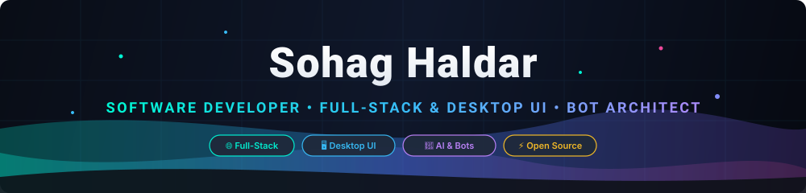

<!-- ============================================================================== -->
<!-- 🌌 SOHAG HALDAR — OFFICIAL GITHUB PROFILE                                      -->
<!-- ============================================================================== -->

<p align="center">
  
</p>

<p align="center">
  <a href="https://github.com/sohaghaldar">
    
  </a>
</p>

<p align="center">
  <a href="https://github.com/sohaghaldar?tab=followers"></a>
  <a href="https://github.com/sohaghaldar?tab=repositories"></a>
  <a href="https://sohaglinks.rf.gd/"></a>
  <a href="https://github.com/sohaghaldar/Desktop_floating-v1form/releases"></a>
</p>

---

## 🏆 Achievements & Milestones (অর্জনসমূহ)


<div align="center">

| 🏅 Domain | 🌟 Core Specialization | ⚡ Milestone Accomplished |
| :--- | :--- | :--- |
| 💻 **Software Engineering** | Multi-Stack Systems & Architecture | End-to-end design from low-level systems to modern web applications |
| 🌐 **Full-Stack & Web** | Responsive Web & Modern UI | Modern responsive layouts with HTML5, CSS3, JavaScript, and dynamic APIs |
| 🕷️ **Desktop UI/UX Physics** | Procedural Animation & Kinematics | Real-time 8-legged Inverse Kinematics (IK), silk physics & multi-OS overlay |
| 🤖 **Bot & Automation** | Asynchronous Engines & Bots | High-throughput multi-threaded bots, background daemons & webhook pipelines |
| 📦 **Software Packaging** | Multi-Platform Distribution | Standalone Windows `.exe`, multi-OS pip wheels, and portable bundles |

</div>

---

## 👨‍💻 About Me (আমার সম্পর্কে)

```yaml
Name: SoHag Haldar
Role: Software Developer & Multi-Stack Systems Architect
Domains: Full-Stack Web Development, Native Desktop UI/UX, AI Bots & Automation
Languages: Python, JavaScript, HTML5/CSS3, C++, Bash, PowerShell
Location: Bangladesh 🇧🇩
Flagship Ecosystem: Desktop Floating (Living Cyber Pets)
Package: pip install desktop-floating
Personal Portfolio: https://sohaglinks.rf.gd/
GitHub Profile: https://github.com/sohaghaldar
```

- 🔭 **What I Build:** From high-performance **desktop companions** with living procedural physics to modern **full-stack web applications** and **autonomous AI bots**.
- 💡 **Philosophy:** Building software that is not only functional, but interactive, visually delightful, and blazing fast.
- 🌱 **Continuous Exploration:** Advanced web technologies, native OS composite window layers (Windows, Linux, macOS), and asynchronous event loops.
- 💬 **Ask Me About:** Modern Web development (HTML/CSS/JS), Desktop GUI & transparent overlays, Inverse Kinematics physics, and Telegram/Discord bot architectures.

---

## 🌟 Featured Repositories (প্রধান রিপোজিটরি ও প্রজেক্টসমূহ)

<div align="center">

<a href="https://github.com/sohaghaldar/Desktop_floating-v1form">
  
</a>
<a href="https://github.com/sohaghaldar/sohaghaldar">
  
</a>

<br/>

<a href="https://github.com/sohaghaldar/My-first-python-">
  
</a>
<a href="https://github.com/sohaghaldar/Sohag">
  
</a>

</div>

---

## 🛠️ Tech Stack & Toolbox (প্রযুক্তি ও দক্ষতা)

### 🌐 Full-Stack & Web Development
<p align="left">
  
  
  
  
  
  
  
</p>

### 🖥️ Desktop UI & Systems Architecture
<p align="left">
  
  
  
  
  
  
  
</p>

### 🤖 Bots, AI & Automation
<p align="left">
  
  
  
  
  
</p>

### ⚙️ DevOps, Tools & Version Control
<p align="left">
  
  
  
  
  
  
</p>

---

## 📊 GitHub Statistics & Analytics (পরিসংখ্যান)

<p align="center">
  
  
</p>

<p align="center">
  
</p>

---

## 🌐 Connect With Me (যোগাযোগ)

<p align="center">
  <a href="https://sohaglinks.rf.gd/" target="_blank">
    
  </a>
  <a href="https://github.com/sohaghaldar" target="_blank">
    
  </a>
</p>

<p align="center">
  
</p>
